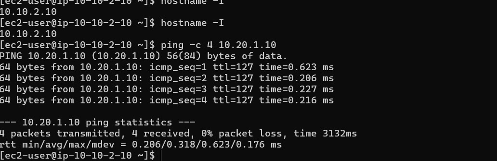
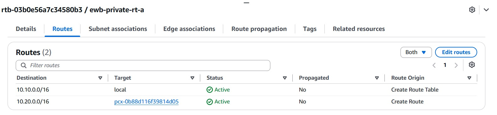
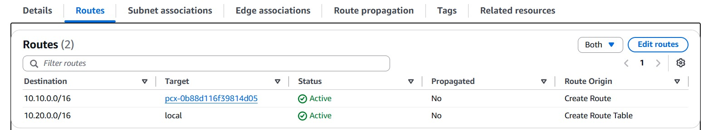
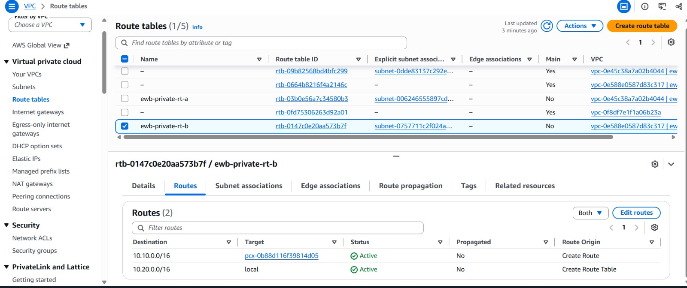
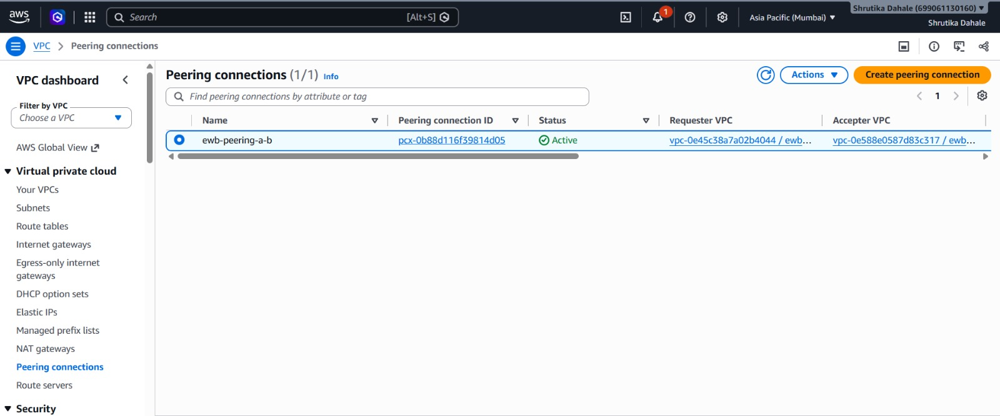

# AWS-VPC-Peering
AWS VPC Peering Project

📌 Project Overview

This project demonstrates private network communication between two Amazon Virtual Private Clouds (VPCs) using AWS VPC Peering.

🎯 Objectives

- Create two separate VPCs with non-overlapping CIDR blocks.
- Configure public and private subnets.
- Establish a VPC Peering connection.
- Configure route tables and security groups.
- Launch EC2 instances.
- Verify private connectivity using ICMP ping.

🛠️ AWS Services Used

- Amazon VPC
- Amazon EC2
- VPC Peering
- Route Tables
- Internet Gateway
- Security Groups

🌐 Network Configuration

VPC A

- VPC Name: "ewb-vpc-a"
- CIDR Block: "10.10.0.0/16"

Subnets:

- Public Subnet A: "10.10.1.0/24"
- Private Subnet A: "10.10.2.0/24"

EC2 Instance:

- App-A Private IP: "10.10.2.10"

VPC B

- VPC Name: "ewb-vpc-b"
- CIDR Block: "10.20.0.0/16"

Subnet:

- Private Subnet B: "10.20.1.0/24"

EC2 Instance:

- App-B Private IP: "10.20.1.10"

VPC Peering

- Peering Connection: "ewb-peering-a-b"
- Status: Active
- VPC A Route: "10.20.0.0/16" → VPC Peering
- VPC B Route: "10.10.0.0/16" → VPC Peering

⚙️ Implementation Steps

1. Created two VPCs with separate CIDR blocks.
2. Created the required public and private subnets.
3. Created and activated a VPC Peering connection.
4. Configured route tables to route traffic between the two VPCs.
5. Configured security group rules for the required traffic.
6. Launched EC2 instances in the private subnets.
7. Connected to App-A through the Bastion host.
8. Tested connectivity from App-A to App-B using ICMP ping.

🧪 Connectivity Test

Command executed on App-A:

ping -c 4 10.20.1.10

Result:

- Packets transmitted: 4
- Packets received: 4
- Packet loss: 0%
- Average response time: 0.318 ms

Outcome: The ping test was successful, confirming connectivity from App-A to App-B.

📸 Project Screenshots

Screenshots demonstrating the following configurations and results will be included in this repository:

- VPC Peering connection status
- Route table configuration for VPC A
- Route table configuration for VPC B
- EC2 instance status
- Successful ping test

🎓 Learning Outcomes

- Understanding Amazon VPC networking.
- Configuring VPC Peering connections.
- Managing route tables and security groups.
- Connecting to private EC2 instances through a Bastion host.
- Testing network connectivity using ICMP ping.

📝 Conclusion

This project provided hands-on experience in configuring AWS VPC Peering and verifying private network connectivity between EC2 instances in two separate VPCs.

---

Project: AWS VPC Peering
Platform: Amazon Web Services (AWS)
## 📸 Project Screenshots

